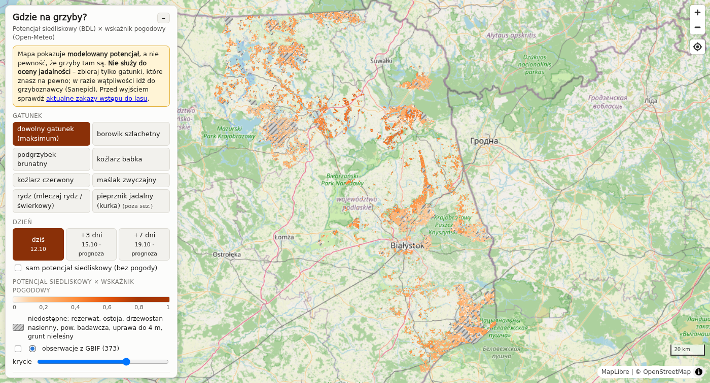

# Grzyby – mapa potencjału grzybów jadalnych (RDLP Białystok / Podlasie)

Pipeline w Pythonie, który z danych Banku Danych o Lasach (BDL), pogody z Open-Meteo i obserwacji
z GBIF buduje **jeden plik `output/mapa.html`**: mapę wydzieleń leśnych pokolorowanych według
**potencjału siedliskowego × wskaźnika pogodowego** dla siedmiu gatunków grzybów jadalnych.

> **Mapa pokazuje modelowany potencjał, a nie pewność występowania grzybów i nie służy do oceny
> jadalności.** Zbieraj tylko gatunki, które znasz na pewno. W razie wątpliwości idź do grzyboznawcy
> (stacje sanitarno-epidemiologiczne). Przed wyjściem sprawdź aktualne zakazy wstępu do lasu.



## Uruchomienie

Wymagany Nix z flakes. Wszystkie komendy uruchamiaj w katalogu repozytorium (stąd brane są
`config.yaml`, `dane.txt`, `data/` i `output/`).

```sh
nix run .#mapa      # pełny pipeline: pobranie BDL → siedliska → pogoda → GBIF → output/mapa.html
nix run .#pogoda    # szybkie odświeżenie: tylko pogoda z Open-Meteo i przebudowa HTML
nix run .#zrzut     # zrzut ekranu i test mapy w headless Chromium (Linux)
```

To samo w devShellu (`nix develop`, albo automatycznie przez direnv):

```sh
python -m grzyby              # = wszystko
python -m grzyby pogoda       # odświeżenie pogody (cache 3 h; --force wymusza pobranie)
python -m grzyby rozpoznanie  # sam raport z rozpoznania danych → output/rozpoznanie.md
python -m grzyby gbif         # ponowne pobranie i ocena obserwacji GBIF
python -m grzyby mapa         # przebudowa HTML z danych pośrednich
python -m grzyby zrzut        # wymaga chromium w PATH
```

Orientacyjne czasy na Raspberry Pi 4: pełny pipeline ok. 15 min, `pogoda` ok. 3–4 min.
Pobieranie pogody jest dławione do limitu darmowego API Open-Meteo (600 wywołań/min, a każda
lokalizacja z 38 dniami danych liczy się jako ok. 2,7 wywołania). Na zwykłym PC całość jest kilka
razy szybsza. Mapę otwiera się bezpośrednio z dysku (`file://…/output/mapa.html`). Potrzebny jest
internet, bo MapLibre GL ładuje się z CDN, a podkład to kafelki OSM. Wymagana przeglądarka
z `DecompressionStream` (Chrome/Edge 80+, Firefox 113+, Safari 16.4+).

Bez Nixa: Python ≥ 3.11 i `pip install geopandas pyogrio shapely pyproj pandas numpy requests pyyaml`,
potem `python -m grzyby`.

### Strojenie

Wszystkie progi i reguły są w [`config.yaml`](config.yaml): żywiciele i ich wagi, krzywe wieku,
tabele siedlisk, sezony, progi opadu i temperatury, przymrozek, premia za „wysyp”, wykluczenia,
siatka pogodowa, parametry GBIF i mapy. Zmiany w sekcjach `pogoda` lub `sezon` wystarczy
przeliczyć przez `nix run .#pogoda`. Zmiany w regułach siedliskowych wymagają `nix run .#mapa`.

## Dane

| Źródło | Co | Jak |
|---|---|---|
| [Bank Danych o Lasach](https://www.bdl.lasy.gov.pl/) | wydzielenia (geometria, siedlisko, składy gatunkowe, wiek, wysokość, ochronność) | paczki SHP+TXT z linków w `dane.txt`, pobierane do `data/raw/` |
| [Open-Meteo](https://open-meteo.com/en/docs) (CC BY 4.0) | dzienne opady, Tmin, Tśr; godzinowa wilgotność gleby 3–9 cm | `/v1/forecast`, `past_days=30`, `forecast_days=8`, siatka co 5 km |
| [GBIF](https://www.gbif.org/) | obserwacje 8 taksonów (rydz = 2 gatunki) | `/v1/occurrence/search` w prostokącie wokół nadleśnictw + 10 km |
| [OpenStreetMap](https://www.openstreetmap.org/copyright) | podkład mapy | kafelki `tile.openstreetmap.org` |

`dane.txt` zawiera 16 z 28 nadleśnictw RDLP Białystok. Sześć z nich leży w woj.
warmińsko-mazurskim (Borki, Czerwony Dwór, Drygały, Ełk, Giżycko, Gołdap), a brakuje części
podlaskich (m.in. Łomża, Nurzec, Płaska, Rajgród, Supraśl, Szczebra, Waliły, Żednia). Żeby objąć
więcej obszaru, dopisz linki do `dane.txt`, bo pipeline bierze wszystkie znalezione tam paczki.
Parki narodowe (Białowieski, Biebrzański, Narwiański, Wigierski) i lasy prywatne nie są w BDL,
więc nie ma ich na mapie.

Warunki BDL: przy ponownym wykorzystaniu trzeba podać źródło i datę danych, a przetworzenie danych
zgłosić na bdl@bdl.lasy.gov.pl. Surowe dane i wyniki (`data/`, `output/`) nie są w repozytorium.

## Krok 1 – rozpoznanie danych (wnioski)

Pełny raport z realnymi wartościami kodów generuje `python -m grzyby rozpoznanie` do
`output/rozpoznanie.md`. Kopia dla paczek 2026 leży w [`docs/rozpoznanie.md`](docs/rozpoznanie.md). Najważniejsze ustalenia:

- **Układ współrzędnych**: `.prj` to ESRI-owy opis `ETRS_1989_Poland_CS92`. Parametry są identyczne
  z **EPSG:2180**, choć pyproj rozpoznaje go jako „ETRF2000-PL / CS92” i nie przypisuje kodu przy
  domyślnej pewności. Pipeline sprawdza parametry i ustawia EPSG:2180.
- **Kodowanie**: wszystkie pliki tekstowe są w **UTF-8**, a nie CP1250 (`.cpg` = UTF-8). CP1250
  zostało jako zapasowe kodowanie w `config.yaml`.
- **Skala**: 134 964 wydzielenia w `f_subarea.txt`, 113 435 poligonów w `G_SUBAREA`. Drogi,
  linie podziału i rowy nie mają poligonów. Kilka wydzieleń jest zapisanych jako kilka rekordów
  i pipeline je scala.
- **`G_SUBAREA`** ma kolumny `a_i_num, adr_for, area_type, site_type, silvicult, forest_fun,
  stand_stru, rotat_age, sub_area, prot_categ, species_cd, part_cd, spec_age, a_year`, ale tylko
  **gatunek panujący**.
- **Pełne składy są w `f_storey_species.txt`**: każdy gatunek w każdym piętrze z udziałem
  (`1`–`10` = 10–100%, `MJS` = miejscami < 5%, `PJD` = pojedynczo < 5%), wiekiem i wysokością.
  97% drzewostanów ma więcej niż jeden gatunek, więc model korzysta z pełnych składów
  z domieszkami.
- **Kody gatunków** (najczęstsze w piętrach drzew): `ŚW, BRZ, SO, DB, OL, GB, LP, OS, KL, DB.S, JS,
  MD, WZ, DB.C, JW, IWA, BK, WB, BRZ.O…`. Kropka oznacza gatunek w rodzaju (`DB.S` – dąb szypułkowy,
  `DB.C` – dąb czerwony, `BRZ.O` – brzoza omszona, `SO.WE` – wejmutka).
- **Kody siedlisk** (wielkie litery z polskimi znakami): `BMŚW, LMŚW, LŚW, BŚW, OL, LW, LMW, LMB,
  BMW, OLJ, BMB, BB, BW, LŁ, BS`. Kodów górskich i wyżynnych nie ma, a 29% wydzieleń nie ma siedliska
  (grunty nieleśne, drogi itp.).
- **Rodzaje powierzchni** (`area_type_cd`, 124 kody): `D-STAN` = drzewostan. Flaga `type_fl`
  w słowniku `f_area_type_dic` rozróżnia grunty leśne (`L`) i nieleśne (`N`: role, łąki,
  pastwiska, bagna, wody, zabudowa, zadrzewienia…).
- **Rezerwaty** oznacza funkcja lasu `forest_func_cd` (`REZ`, `REZ CZ`; słownik zna też `REZ Ś`).
- **Kategorie ochronności** (`f_arod_category`): `OCH CENNE, OCH WOD, OCH MIAST, OCH OSTOJ, OCH OBR,
  OCH UZDR, OCH BADAW, OCH GLEB, OCH NAS`.
- **Wysokość** drzewostanu jest podana w 99,5% wydzieleń, więc do rozpoznania upraw służy
  wysokość (≤ 4 m), a wiek (< 10 lat) tylko awaryjnie.

## Model

### Krok 2 – potencjał siedliskowy (0–1)

Liczony dla każdego wydzielenia i gatunku grzyba:

```
udział_ważony = Σ udział_gatunku × waga_piętra × waga_żywiciela
czynnik_ż×w   = min(1, Σ udział_gatunku × waga_piętra × waga_żywiciela × krzywa_wieku(wiek_tego_gatunku) / nasycenie)
potencjał     = czynnik_ż×w × czynnik_siedliska(typ_siedliskowy)
```

- Wagi pięter: drzewostan/I piętro 1,0, II piętro 0,6, przestoje 0,3, podrost 0,3/0,15.
  Podszyt, nalot i zakrzewienia są pomijane.
- Żywiciel jest szukany po pełnym kodzie (`DB.C`), a potem po rodzaju (`DB.S` → `DB`).
- Wiek jest brany z konkretnego żywiciela w danym piętrze, a nie z gatunku panującego.
- `nasycenie` to udział żywiciela, który wystarcza do pełnej wartości. Dla koźlarzy jest niski
  (0,3 i 0,2), bo wystarczy domieszka.
- Siedliska bagienne i olsy (`BB, BMB, LMB, OL, OLJ`, a także `LŁ`) mają czynnik 0,05–0,2.

| gatunek | żywiciele | wiek | siedliska (czynnik 1,0) | sezon |
|---|---|---|---|---|
| borowik szlachetny | ŚW, SO, BK, DB (+BRZ 0,5, GB 0,3, DB.C 0,5) | pełny od 40 lat | BŚW, BMŚW, LMŚW, LŚW | VI–X |
| podgrzybek brunatny | SO, ŚW (+MD 0,3) | od 20 lat | BŚW, BMŚW, BW, BMW | VIII–XI |
| koźlarz babka | BRZ (też domieszka) | od 10 lat | szeroko; bagienne 0,2 | VI–X |
| koźlarz czerwony | OS (+TP 0,5; też domieszka) | od 10 lat | LŚW, LMŚW, BMŚW | VI–X |
| maślak zwyczajny | SO | 10–30 lat (spadek później) | BS, BŚW | VI–XI |
| rydz (*L. deliciosus* / *L. deterrimus*) | SO / ŚW | 10–30 lat | BŚW, BMŚW | VIII–X |
| kurka | SO, ŚW, BK, DB | od 20 lat | BŚW, BMŚW (BS 0,8) | VI–IX |

### Krok 3 – wskaźnik pogodowy (0–1)

Pogodę pobiera się dla siatki co 5 km (575 punktów, tylko węzły, przy których są wydzielenia).
Każde wydzielenie dostaje najbliższy węzeł siatki. Wskaźnik liczy się na dziś, +3 i +7 dni.
Dni +3 i +7 korzystają z prognozy Open-Meteo.

```
opad      = krzywa(Σ opadu z 14 dni: 0 mm→0, 15 mm→0,25, 40 mm→1)
            + 0,15, jeśli 7–14 dni wcześniej spadło ≥ 15 mm w 2 dni (początek wysypu)
wilgoć    = 0,7 × opad + 0,3 × krzywa(wilgotność gleby 3–9 cm: 0,10→0, 0,20→0,6, 0,30→1)
temp      = krzywa(średnia T z 7 dni: <5°C słabo, 10–20°C = 1, >25°C słabo)
mróz      = 0,25, jeśli Tmin < −1°C w ostatnich 5 dniach, inaczej 1
pogoda    = wilgoć × temp × mróz × sezon(gatunek, miesiąc)    # poza sezonem = 0
```

**Kolor wydzielenia = potencjał siedliskowy × wskaźnik pogodowy.** Widok „dowolny gatunek” pokazuje
maksimum po gatunkach. Przełącznik „sam potencjał siedliskowy” wyłącza pogodę, co przydaje się
np. dla kurki w październiku, kiedy jest poza sezonem.

### Krok 4 – wykluczenia („niedostępne”, szare i kreskowane)

Gdy wydzielenie spełnia kilka warunków, liczy się pierwszy z listy:

1. **rezerwaty przyrody**: funkcja lasu `REZ`, `REZ CZ`, `REZ Ś`;
2. **stały zakaz wstępu** z art. 26 ust. 2 ustawy o lasach, według kategorii ochronności:
   ostoje zwierząt (`OCH OSTOJ`), drzewostany nasienne (`OCH NAS`), powierzchnie badawcze
   i doświadczalne (`OCH BADAW`);
3. **uprawy leśne do 4 m**: najwyższa wysokość gatunku w piętrze górnym ≤ 4 m, a gdy brak
   wysokości, wiek < 10 lat;
4. **powierzchnie nieleśne**: `type_fl = N`.

W obecnych danych 83 161 wydzieleń jest dostępnych. Wykluczone: nieleśne 14 538, rezerwaty
4 899 + 1 831 (częściowe), ostoje 4 115, uprawy 3 984, powierzchnie badawcze 296, nasienne 68.

### Krok 5 – mapa

`output/mapa.html` to jeden plik ok. 15 MB. MapLibre GL 4.7.1 ładuje się z cdnjs, podkład to OSM.
Geometria jest uproszczona metodą *coverage simplify* (4 m, sąsiednie wydzielenia zachowują
wspólne granice), przeliczona do EPSG:4326 i zaokrąglona do 1e-5° (~1 m). Współrzędne są
zakodowane różnicowo, a cały zestaw danych (52 MB JSON) skompresowany gzipem do 11 MB i osadzony
w base64. Przeglądarka rozpakowuje go natywnie (`DecompressionStream`). Odświeżenie pogody
podmienia tylko mały blok JSON z wskaźnikami dla punktów siatki. Kolor liczy wyrażenie MapLibre
`p_gatunku × pogoda[węzeł]`, więc przełączenie gatunku lub dnia nie wymaga przeliczania danych.

Na mapie są:
- przełącznik gatunku z widokiem „dowolny gatunek” (maksimum) oraz przełącznik dnia (dziś, +3, +7);
- legenda, data pobrania pogody i stałe ostrzeżenie, że mapa pokazuje potencjał, a nie pewność,
  i nie służy do oceny jadalności;
- popup wydzielenia: nadleśnictwo i adres leśny, rodzaj i powierzchnia, siedlisko, wiek i wysokość,
  pełny skład z piętrami, kategorie ochronności, powód wykluczenia, tabela wyników dla wszystkich
  gatunków oraz uzasadnienie (żywiciele, wiek, siedlisko, składniki pogody z danego punktu siatki);
- opcjonalna warstwa obserwacji GBIF dla wybranego gatunku;
- regulowane krycie i lokalizacja GPS.

## Krok 6 – weryfikacja

### GBIF (sanity check, nie trening)

W prostokącie wokół nadleśnictw (+10 km) GBIF ma 373 obserwacje tych gatunków. Większość leży poza
lasami z BDL: w parkach narodowych, lasach prywatnych i na Litwie lub Białorusi. Do wydzieleń
leśnych trafia 36, a z buforem 200 m na niepewność położenia 48. Wyniki dla progu „wysokiego
potencjału” ≥ 0,5:

| gatunek | obs. w wydz. (+≤200 m) | w wysokim potencjale | udział powierzchni lasu o wysokim potencjale | średni potencjał: obserwacje / las |
|---|---:|---:|---:|---:|
| borowik szlachetny | 7 (+4) | 100% | 73% | 0,92 / 0,73 |
| podgrzybek brunatny | 14 (+3) | 65% | 55% | 0,69 / 0,52 |
| koźlarz babka | 2 | 0% | 21% | 0,20 / 0,30 |
| koźlarz czerwony | 2 | 0% | 4% | 0,05 / 0,07 |
| maślak zwyczajny | 1 (+3) | 0% | 8% | 0,11 / 0,15 |
| rydz | 2 (+1) | 100% | 32% | 0,79 / 0,36 |
| kurka | 5 | 60% | 56% | 0,54 / 0,55 |

Dla gatunków z najliczniejszymi obserwacjami (borowik, podgrzybek) odsetek obserwacji w wydzieleniach
o wysokim potencjale jest wyższy niż odsetek takiej powierzchni (lift 1,4 i 1,2). Próby są jednak
bardzo małe (1–17 obserwacji na gatunek), więc to tylko kontrola, że model nie jest sprzeczny
z obserwacjami, a nie walidacja. Dla koźlarzy i maślaka obserwacje leżą w wydzieleniach
o niskim potencjale, co może wskazywać na zbyt wąskie reguły. Przy 1–4 punktach nie da się tego
jednak rozstrzygnąć. Szczegóły zapisuje `data/work/gbif_weryfikacja.json`.

### Test w przeglądarce

`nix run .#zrzut` uruchamia headless Chromium przez DevTools Protocol (klient na bibliotece
standardowej). Test czeka na rozpakowanie danych i bezczynność mapy, liczy wyrenderowane wydzielenia,
zbiera błędy JS, klika wydzielenie i zapisuje `output/zrzut.png`, `output/zrzut_popup.png`
i `output/zrzut_raport.json`. Na Raspberry Pi z renderowaniem programowym (SwiftShader) ładowanie
trwa ok. 100 s, na zwykłym komputerze kilka sekund.

## Ograniczenia modelu

- **To heurystyka, nie model statystyczny.** Wagi i progi są ustawione eksperckie i nie zostały
  wyuczone ani skalibrowane. Obserwacji GBIF jest za mało, żeby to zrobić.
- **BDL opisuje drzewostan, nie runo ani glebę.** Nie są uwzględnione: odczyn gleby (poza tym, co
  niesie typ siedliska), pokrywa mszysta, zwarcie, wcześniejsze zbiory, wydeptanie, zabiegi
  gospodarcze po dacie stanu danych.
- **Pogoda jest z modelu, a nie z deszczomierza**, w siatce co 5 km. Lokalne burze bywają pominięte.
  „+3” i „+7” to prognoza, im dalej, tym mniej pewna. Wilgotność gleby z modelu jest tylko
  orientacyjna.
- **Wysypy grzybów są losowe i silnie zależą od mikroklimatu.** Wysoki wynik oznacza „warto
  sprawdzić”, a nie „są grzyby”.
- **Sezony to sztywne miesiące.** Pierwszego dnia miesiąca wskaźnik skacze, a lata wczesne
  i późne nie przesuwają sezonu.
- **Wykluczenia nie są kompletne.** BDL nie zawiera czasowych zakazów wstępu (zagrożenie pożarowe,
  prace leśne, polowania), strefy przygranicznej z Białorusią, stref ochronnych gatunków chronionych
  (lokalizacje są niejawne), źródlisk ani obszarów zagrożonych erozją. Ostoje są ujęte tylko wtedy,
  gdy BDL ma kategorię `OCH OSTOJ`. Zakłada się, że w każdym rezerwacie obowiązuje zakaz zbioru,
  co jest uproszczeniem: plan ochrony może zbiór dopuszczać. Aktualne zakazy wstępu do lasu
  sprawdzisz na [bdl.lasy.gov.pl](https://www.bdl.lasy.gov.pl/portal/mapa-zakazow-wstepu) i w nadleśnictwie.
- **Zasięg**: tylko lasy Państwowego Gospodarstwa Leśnego Lasy Państwowe z nadleśnictw w `dane.txt`
  (zob. „Dane”).
- **Rydz** łączy dwa gatunki: *L. deliciosus* przy sośnie i *L. deterrimus* przy świerku.
  Uzasadnienie w popupie pokazuje, który żywiciel dominuje.

## Struktura

```
config.yaml          progi i reguły (strojenie)
dane.txt             linki do paczek BDL
flake.nix            devShell + aplikacje mapa / pogoda / zrzut
grzyby/
  bdl.py             pobieranie i czytanie paczek BDL (zip bez rozpakowywania)
  rozpoznanie.py     Krok 1 – raport z realnych kodów
  habitat.py         Krok 2 i 4 – składy, potencjał siedliskowy, wykluczenia
  weather.py         Krok 3 – siatka, Open-Meteo, wskaźnik pogodowy
  gbif.py            Krok 6 – obserwacje GBIF i statystyki
  mapa.py            Krok 5 – kodowanie geometrii i składanie HTML
  szablon.html       szablon mapy (MapLibre GL, JS)
  zrzut.py           test w headless Chromium (DevTools Protocol)
data/raw, data/work  dane pobrane i pośrednie (poza gitem)
output/              mapa.html, rozpoznanie.md, zrzuty (poza gitem)
```
